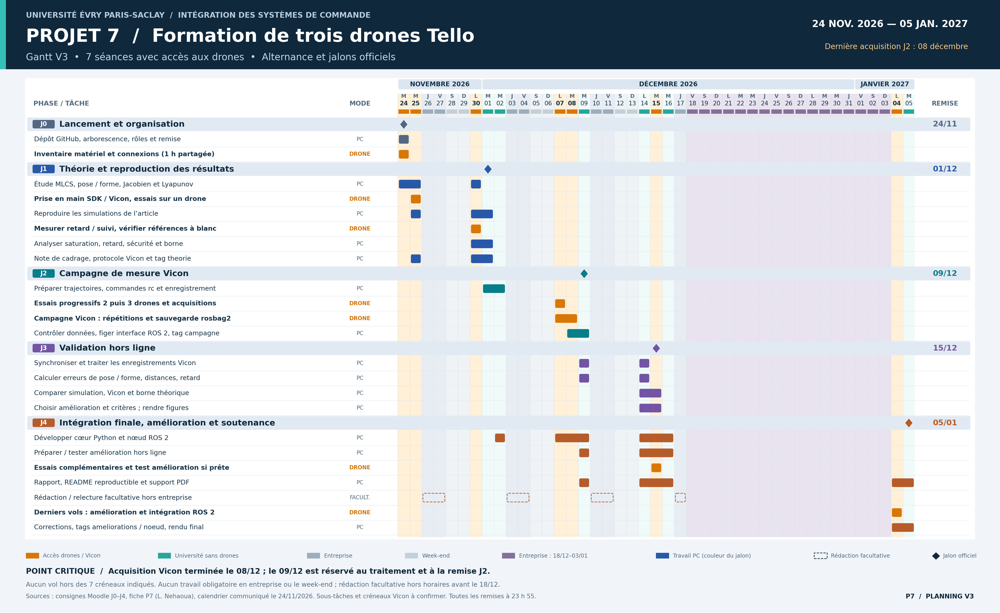

# Projet 7 – Formation de trois drones Tello

## 1. Présentation du projet

Nous travaillons sur un module divisé en 7 projets, nous avons choisi le projet n°7. Voici en quoi il consiste : Trois Tello volent en formation triangulaire selon le schéma de commande multicouche (MLCS) de l'article, permettant de contrôler la trajectoire, la position, l'orientation et la géométrie de la formation. Une couche haute planifie le mouvement et la forme de la formation et calcule les références de chaque drone ; une couche basse fait suivre ces références à chaque drone avec les seules commandes du SDK.

## 2. Objectifs

- Étudier la méthode de commande multicouche MLCS.
- Comprendre et implémenter le modèle de formation.
- Reproduire les résultats de simulation de l'article scientifique.
- Réaliser une campagne expérimentale avec trois drones Tello et le système de capture de mouvement Vicon.
- Comparer les résultats théoriques, simulés et expérimentaux.
- Étudier l'influence des retards et des erreurs de suivi.
- Proposer et valider une amélioration de la commande.
- Développer et intégrer un nœud ROS 2 de la couche haute.

## 3. Membres du groupe et répartition des rôles

| Membre    | Rôle                       | Responsabilités |
|---|---|---|
| Alexandre & Ralph   | Intégration validation     | Python, validation hors ligne, comparaison simulation/expérimentation |
| Kaushik & **Guillaume** | Théorie et simulation      | Modélisation, lois de commande, MATLAB |
| **Jan** & Kaushik       | Essais et données          | Protocole expérimental, Vicon, acquisition |
| Ralph & Alexandre   | Coordination               | GitHub, planning, documentation et livrables |

## 4. Architecture du système

Le système repose sur deux couches principales :

### Couche haute

- Planification de la trajectoire de formation.
- Définition de la pose et de la forme du triangle.
- Calcul des références de position et de vitesse.
- Gestion des contraintes de sécurité.

### Couche basse

- Suivi des références par chaque drone.
- Conversion des références en commandes SDK Tello.
- Utilisation du retour de position fourni par Vicon.

## 5. Organisation du dépôt

```text
Projet-7-Formation_de_trois_drones/
├── README.md
├── doc/           # Rapports, documentation et planning
├── theorie/       # Étude théorique et bibliographie
├── matlab/        # Modélisation et simulations MATLAB
├── python/        # Algorithmes et traitement des données
├── ressources/    # Fichiers fournis par M.Nehaoua
├── ros2_ws/
│   └── src/       # Packages et nœuds ROS 2
├── data/          # Données expérimentales et mesures Vicon
└── resultats/     # Figures et résultats de validation
```
## 6. Planning et jalons

| Jalon | Description | Date limite |
|---|---|---|
| J0 | Création du dépôt GitHub et répartition des rôles | 24/11/2026 |
| J1 | Théorie et reproduction des résultats | 01/12/2026 |
| J2 | Campagne de mesure Vicon | 09/12/2026 |
| J3 | Validation hors ligne | 15/12/2026 |
| J4 | Rapport final, nœud ROS 2 et soutenance | 05/01/2027 |

### 6.1. Diagramme de Gantt

Le planning prévisionnel tient compte du calendrier d'alternance, des créneaux d'accès aux drones et au système Vicon, ainsi que des échéances de remise des différents livrables.

<p align="center">
  
</p>

<p align="center">
  <i>Figure 1 – Diagramme de Gantt du projet 7</i>
</p>

### 6.2. Créneaux d'accès aux drones

| Date | Activités expérimentales prévues |
|---|---|
| 24/11/2026 | Prise en main du matériel et de l'environnement |
| 25/11/2026 | Premiers essais et prise en main du SDK Tello |
| 30/11/2026 | Essais unitaires et caractérisation |
| 07/12/2026 | Essais en formation et acquisition Vicon |
| 08/12/2026 | Campagne de mesure Vicon |
| 15/12/2026 | Essais complémentaires et amélioration de la commande |
| 04/01/2027 | Intégration et validation expérimentale finale |

Les activités nécessitant les drones sont concentrées sur ces créneaux. Les autres journées universitaires sont consacrées à la modélisation, à la simulation, au développement logiciel, au traitement des données et à la rédaction.

## 7. Environnement technique

- MATLAB / Simulink
- Python
- ROS 2
- SDK Tello
- Système Vicon
- Git / GitHub

## 8. Reproductibilité des résultats

Les instructions d'installation, d'exécution des simulations,
de traitement des données et de génération des figures seront
ajoutées progressivement au cours du projet.

L'objectif est de permettre la reproduction de chaque figure
et de chaque tableau présentés dans le rapport final.

## 9. Références

- Brandão et al., A Multi-Layer Control Scheme for a
  Centralized UAV Formation, ICUAS, 2014.
- Sujet officiel du projet 7 :
  https://lnehaoua.com/new/integrated_control/pages/formation.html
